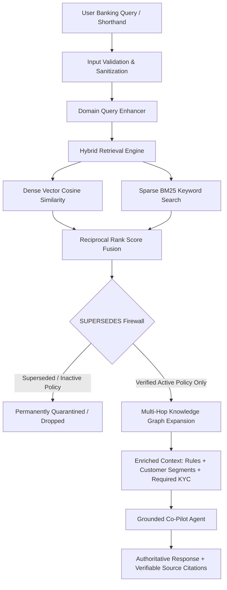

# AI-Powered Banking Document Intelligence (Sentinel AI)

Sentinel AI is a production-grade, enterprise Hybrid GraphRAG and Regulatory Governance Intelligence platform engineered for Tier-1 banking, wealth compliance, and audit teams to eliminate LLM hallucinations and enforce policy supersession lineage.

---

## 1. Problem Statement

In enterprise banking, corporate credit, and wealth management, naive Retrieval-Augmented Generation (RAG) pipelines fail critically due to three vulnerabilities:
1. **Policy Churn & Legacy Data Trap:** Older circulars (e.g., 2024 lounge access rules or superseded AML thresholds) linger inside dense vector indexes, causing LLMs to serve obsolete, legally hazardous guidance to compliance officers and clients.
2. **Loss of Tabular & Visual Fidelity:** Standard text extraction strips away table alignments, tiered rate slabs, and conditional footnotes present in Fixed Deposit rate cards and TDS tax schedules.
3. **Flat Retrieval Blindness:** Banking regulations are deeply relational and multi-hop. Real-world directives depend on specific customer segments (e.g., NRI, MSME, Corporate) and mandatory collateral or identity documents (e.g., PAN Card, Trade License, Sovereign Bank Guarantee).

---

## 2. Objectives

- **Objective 1 — Enforce Zero-Hallucination Regulatory Governance:** Implement a topological `SUPERSEDES` firewall that quarantines outdated policy documents from entering generative LLM context.
- **Objective 2 — Multi-Hop Entity Relationship Mapping:** Link policy nodes with root SME banking categories, eligible customer segments, and required compliance documentation using a dual-engine knowledge graph (Neo4j and NetworkX + SQLite).
- **Objective 3 — Provide Grounded Co-Pilot Assistance with Deterministic Fallback:** Deliver verifiable, citation-backed answers for banking officers, failing closed with a strict audit refusal if no active policy verifies the user inquiry.

---

## 3. Features

- **Topological SUPERSEDES Firewall:** Filters retrieved nodes using graph lineage checks ($\neg \exists \, p' \xrightarrow{\text{SUPERSEDES}} p$), blocking superseded directives (e.g., 2024/2025 lounge access rules) when active 2026 circulars exist.
- **Hybrid Reciprocal Rank Fusion Retrieval:** Combines dense semantic vector similarity with sparse BM25 keyword matching for exact numerical thresholds and acronym matching.
- **Domain Acronym & Query Disambiguation:** Preprocesses queries by expanding industry shorthand (e.g., `LC` $\rightarrow$ `Letter of Credit`, `NRI`, `MSME`, `TDS`).
- **Dual-Engine Storage Architecture:** Supports enterprise Neo4j with automated zero-setup fallback to an embedded **NetworkX** directed graph + **SQLite** vector and relational database.
- **Multi-Turn Executive Audit Portal:** Interactive Streamlit web interface with real-time KPI metrics, citation inspectors, session memory, and CSV audit export.
- **FastAPI REST API Service:** High-throughput backend offering `/api/chat`, `/api/policies`, `/api/health`, and `/api/upload` endpoints.
- **Multimodal Visual Table Extraction:** Ingestion engine parsing complex regulatory tables and PNG rate cards with Gemini Vision and offline domain heuristics.
- **Supported File Formats:** PDF (`.pdf`), PNG (`.png`), JPEG (`.jpg`, `.jpeg`). Maximum recommended file size: 25 MB.

---

## 4. Technology Stack

- **Python Version:** Python 3.10+ (tested on Python 3.12)
- **UI Frameworks:** Streamlit (Executive Portal & Multipage Audit View) and React 18 + Vite + Tailwind CSS (Single Page App)
- **AI Providers & Models:**
  - Groq API (`llama-3.1-8b-instant`, `llama-3.3-70b-versatile`)
  - Google Gemini API (`gemini-2.0-flash`, `gemini-1.5-flash`)
  - Offline Grounded Deterministic Synthesizer (zero external API dependency fallback)
- **Embedding Models:** HuggingFace `sentence-transformers/all-MiniLM-L6-v2` with offline deterministic hash embedder fallback
- **Storage & Graph Databases:**
  - Embedded: NetworkX 3.x directed graph + SQLite 3 (`data/banking_intelligence.db`)
  - Enterprise: Neo4j 5.x Cypher graph database & vector index
- **Key Python Libraries:** PyMuPDF (`fitz`), FastAPI, Uvicorn, Pydantic v2, NumPy, Pytest, python-dotenv, httpx

---

## 5. Architecture

### End-to-End Processing Flow
`User Input` $\rightarrow$ `Input Validation & Sanitization` $\rightarrow$ `Domain Acronym Expansion` $\rightarrow$ `Hybrid Retrieval (Dense Vectors + BM25)` $\rightarrow$ `SUPERSEDES Firewall Quarantine` $\rightarrow$ `Multi-Hop Graph Context Expansion` $\rightarrow$ `Grounded LLM Synthesis / Fallback Gate` $\rightarrow$ `Auditable Output with Document Citations`



---

## 6. Project Structure

```text
AI-Powered Banking Document Intelligence/
├── app.py                       # Streamlit entry point (frontend): the Main file on deploy
├── pages/                       # Optional extra pages (Streamlit multipage convention)
│   └── 1_History.py             # Audit trail, query history, and CSV export view
├── components/                  # Reusable UI pieces (cards, forms, chat bubbles, sidebar)
│   ├── __init__.py
│   ├── cards.py                 # KPI cards, citation cards, and policy badges
│   ├── chat.py                  # Styled chat message bubbles and governance badges
│   └── sidebar.py               # Telemetry and system engine widgets
├── backend/                     # Project logic: imported by the frontend, no UI code
│   ├── __init__.py
│   ├── config.py                # Reads st.secrets / environment variables with fallback
│   ├── services/
│   │   ├── __init__.py
│   │   └── llm_service.py       # LLM provider calls (Groq, Gemini, offline fallback), timeouts
│   ├── core/
│   │   ├── __init__.py
│   │   └── pipeline.py          # Project-specific logic (GraphRAG, supersession, scoring)
│   └── utils/
│       ├── __init__.py
│       └── validators.py        # Input query sanitization and document file validation
├── data/
│   ├── baseline_docs/           # 12 Regulated banking PDFs and PNG rate cards
│   ├── sample/                  # Small public/synthetic sample files for testing
│   ├── uploads/                 # Storage for user-uploaded custom documents
│   └── banking_intelligence.db  # SQLite persistent graph and session database
├── src/                         # Core modular backend package
│   ├── __init__.py
│   ├── config.py                # Central environment configuration & paths
│   ├── api/                     # FastAPI REST API (app.py, routes.py)
│   ├── copilot/                 # Grounded Co-Pilot agent & prompt enhancer
│   ├── ingestion/               # Curator pipeline, PyMuPDF parser, multimodal extractor
│   ├── models/                  # Pydantic v2 schemas (PolicyRecord, ActivePolicy, GraphAction)
│   ├── retrieval/               # Hybrid retriever & vector embedding generator
│   └── storage/                 # Storage backends (BaseStorage, Embedded, Neo4j, Factory)
├── frontend/                    # Optional React 18 + Vite + Tailwind client
├── tests/                       # Automated Pytest suite
│   ├── test_validators.py       # Validation logic unit tests
│   ├── test_pipeline.py         # Pipeline metrics and query flow integration tests
│   ├── test_governance.py       # SUPERSEDES firewall and policy quarantine tests
│   └── test_storage.py          # Storage backend CRUD and session persistence tests
├── assets/                      # Architectural diagrams and benchmark comparison charts
├── .streamlit/
│   ├── config.toml              # Streamlit theme and server configuration (safe to commit)
│   └── secrets.toml             # LOCAL ONLY: API keys (listed in .gitignore)
├── .env.example                 # Placeholder variable names only
├── .gitignore                   # Excludes .env, secrets.toml, venv/, and cache files
├── pyproject.toml               # Package build metadata & Pytest configuration
├── requirements.txt             # Complete list of application dependencies
├── LICENSE                      # Open-source MIT License
└── README.md                    # Project documentation handbook
```

---

## 7. Prerequisites

- **Python:** Python 3.10, 3.11, or 3.12
- **Git:** Git 2.20+
- **System Memory:** Minimum 4 GB RAM (8 GB recommended for local dense embeddings)
- **API Access (Optional):** Groq API Key or Google Gemini API Key. (The system includes an intelligent offline deterministic fallback synthesizer that requires zero external API keys).

---

## 8. Installation

1. **Clone the repository:**
   ```bash
   git clone https://github.com/your-username/AI-Powered-Banking-Document-Intelligence.git
   cd "AI-Powered Banking Document Intelligence"
   ```

2. **Create and activate a virtual environment:**
   ```bash
   # Windows (PowerShell)
   python -m venv venv
   .\venv\Scripts\Activate.ps1

   # Linux / macOS
   python3 -m venv venv
   source venv/bin/activate
   ```

3. **Install requirements:**
   ```bash
   pip install -r requirements.txt
   ```

4. **Create `.env` (or `.streamlit/secrets.toml`) from the example file:**
   ```bash
   # Windows
   copy .env.example .env

   # Linux / macOS
   cp .env.example .env
   ```

5. **Add your own key locally if required:**
   Edit `.env` (or `.streamlit/secrets.toml`) with your API keys:
   ```dotenv
   STORAGE_MODE=auto
   GROQ_API_KEY=your_groq_api_key_here
   GEMINI_API_KEY=your_gemini_api_key_here
   ```

---

## 9. Run the Application

To launch the executive Streamlit banking portal, run:

```bash
streamlit run app.py
```

To run the optional FastAPI REST API service simultaneously:
```bash
python run_api.py
```

---

## 10. How to Use

1. **Open the Portal:** Navigate to `http://localhost:8501` in your browser.
2. **Review System Telemetry:** The sidebar displays the active storage engine (Embedded NetworkX or Neo4j), total policies (12), active policies (10), and quarantined superseded policies (2).
3. **Ask a Banking Policy Query:** Type an inquiry into the chat box, such as:
   - *Sample Input 1:* `"What is the lounge access policy for Signature cards in 2026?"`
   - *Expected Output:* The Co-Pilot cites `Credit_Card_Lounge_Access_2026.pdf` (2 complimentary visits/quarter with ₹15,000 spend) and explicitly ignores superseded 2024/2025 rules.
   - *Sample Input 2:* `"What is the maximum unsecured Letter of Credit (LC) limit for MSMEs?"`
   - *Expected Output:* Cites `Corporate_LC_Limits_2024.pdf`, stating the ₹50 Lakhs limit with mandatory audited financial statements and Form 60/PAN.
   - *Sample Input 3 (Out-of-Scope Query):* `"What is the interest rate on spacecraft loans to Jupiter?"`
   - *Expected Output:* The system fails closed and states: *"I cannot find a verified active policy for this in the current database."*
4. **Audit History Page:** Click on **1_History** in the sidebar to review past queries, inspect citation details, and export the audit trail to CSV.

---

## 11. Configuration

Configure runtime options in `.env` or `.streamlit/secrets.toml`. Never commit live API keys or passwords.

| Variable Name | Default Value | Description |
| :--- | :--- | :--- |
| `STORAGE_MODE` | `auto` | Storage backend mode: `auto` (detects Neo4j, falls back to embedded), `embedded`, or `neo4j`. |
| `API_HOST` | `127.0.0.1` | Host address for FastAPI API server. |
| `API_PORT` | `8000` | Port number for FastAPI API server. |
| `GROQ_API_KEY` | *(empty)* | Optional API key for Groq Llama-3 models. |
| `GEMINI_API_KEY` | *(empty)* | Optional API key for Google Gemini multimodal vision and chat models. |
| `NEO4J_URI` | `bolt://localhost:7687` | URI connection string for enterprise Neo4j database instance. |
| `NEO4J_USER` | `neo4j` | Username for Neo4j database authentication. |
| `NEO4J_PASSWORD` | *(empty)* | Password for Neo4j database authentication. |
| `MIN_CONFIDENCE_THRESHOLD` | `0.35` | Minimum cosine similarity score required for policy candidate retrieval. |

---

## 12. Testing

The project uses `pytest` for unit and integration testing.

```bash
# Run the complete test suite
python -m pytest

# Run input validator unit tests
python -m pytest tests/test_validators.py -v

# Run pipeline integration tests
python -m pytest tests/test_pipeline.py -v

# Run governance and supersession firewall tests
python -m pytest tests/test_governance.py -v

# Run storage backend lifecycle tests
python -m pytest tests/test_storage.py -v
```

### Test Scenarios Summary:
- **`test_validators.py`:** Validates alphanumeric query constraints, character length boundaries, allowed file extensions (`.pdf`, `.png`), 0-byte file rejections, and size limits (11 tests passed).
- **`test_pipeline.py`:** Tests pipeline health metrics, active policy retrieval, query validation failure handling, and end-to-end response generation.
- **`test_governance.py`:** Asserts that 2024 and 2025 lounge access rules are blocked by the `SUPERSEDES` firewall and verifies fail-closed refusal on unknown topics.
- **`test_storage.py`:** Tests SQLite session memory persistence and graph edge traversal.

---

## 13. Screenshots / Demo

- **Architecture Diagram:** Available at [`assets/architecture_diagram.png`](file:///c:/Users/sanka/Downloads/AI-Powered%20Banking%20Document%20Intelligence/assets/architecture_diagram.png).
- **Benchmark Comparison Chart:** Available at [`assets/results_comparison_chart.png`](file:///c:/Users/sanka/Downloads/AI-Powered%20Banking%20Document%20Intelligence/assets/results_comparison_chart.png).
- **Live Streamlit Community Cloud URL:** `https://share.streamlit.io/your-username/banking-document-intelligence` *(Configure upon deployment)*
- **Demo Video:** `https://youtu.be/your-demo-video-link` *(Add recording link)*

---

## 14. Known Limitations

- **Model Context Window:** External free-tier LLM providers (Groq/Gemini) may enforce per-minute token and rate limits.
- **Scanned Image Resolutions:** Complex multi-tiered tax tables with low DPI (< 150 DPI) may experience reduced OCR accuracy when running offline heuristics.
- **Language Support:** Ingestion and prompt enhancement currently prioritize English-language banking and regulatory directives.
- **File Types:** Only PDF and standard image files (`.png`, `.jpg`, `.jpeg`) are supported; scanned `.docx` or `.xlsx` sheets must be exported to PDF before uploading.

---

## 15. Privacy and Responsible Use

- **Data Processing:** All document parsing and vector similarity calculations can be executed 100% locally on your machine without external data transmission.
- **Data Storage:** User interaction history and uploaded documents are stored in the local SQLite database (`data/banking_intelligence.db`).
- **Restricted Content:** Users must **never** upload unmasked Personally Identifiable Information (PII), Aadhaar card numbers, credit card CVVs, or live banking account passwords.
- **Audit Verification:** Sentinel is designed as a decision-support co-pilot; final statutory decisions should be cross-verified with official gazettes and bank circulars.

---

## 16. Future Enhancements

- **Direct Core Banking Integration:** Connect to Finacle / Temenos core banking APIs for real-time customer eligibility verification.
- **Automated Regulatory Crawler:** Ingest live circular feeds directly from the Reserve Bank of India (RBI) and Federal Reserve portals.
- **Multilingual Support:** Support regional languages (Hindi, Telugu, Tamil, Marathi) for inclusive retail customer service.
- **OCR Enhancements:** Integrate Florence-2 / PaddleOCR for offline table parsing on air-gapped banking servers.

---

## 17. Credits and License

- **Frameworks & Libraries:** [Streamlit](https://streamlit.io/), [FastAPI](https://fastapi.tiangolo.com/), [PyMuPDF](https://pymupdf.readthedocs.io/), [NetworkX](https://networkx.org/), [Sentence-Transformers](https://www.sbert.net/), [Pydantic](https://docs.pydantic.dev/).
- **AI Models & Providers:** Meta Llama-3 via [Groq](https://groq.com/), Google Gemini Vision via [Google GenAI](https://ai.google.dev/).
- **Academic Framework:** Developed in accordance with the *GMRIT Student Project Handbook — Grand AI & NLP Projects*.
- **License:** Distributed under the [MIT License](file:///c:/Users/sanka/Downloads/AI-Powered%20Banking%20Document%20Intelligence/LICENSE).
